<div align="center">

# ShadowRealms AI

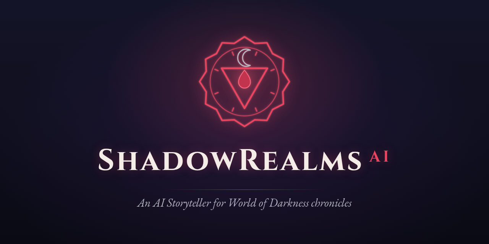

### Self-hosted AI Storyteller for World of Darkness chronicles

[](docs/CHANGELOG.md)
[](https://github.com/Somnius/shadowrealms-ai/actions/workflows/ci.yml)
[](https://github.com/Somnius/shadowrealms-ai/actions/workflows/codeql.yml)
[](LICENSE)

</div>

<div align="center">

### ▶ Watch the trailer

[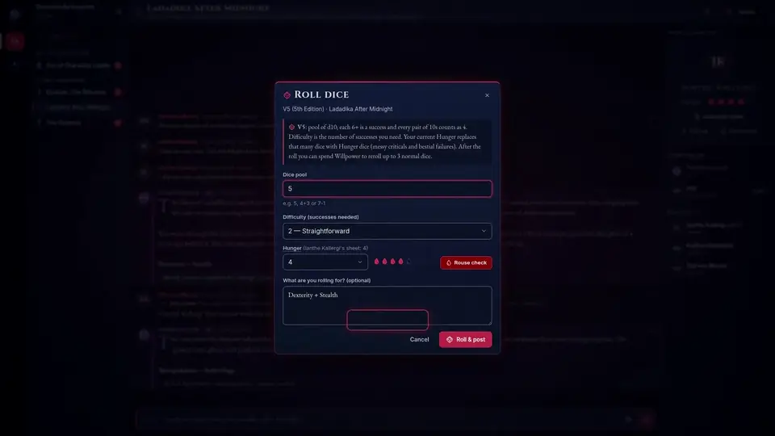](https://github.com/Somnius/shadowrealms-ai/releases/download/trailer-v0.14.0/trailer_en_1080p60.mp4)

**[English (2:30)](https://github.com/Somnius/shadowrealms-ai/releases/download/trailer-v0.14.0/trailer_en_1080p60.mp4)** · **[Ελληνικά (2:30)](https://github.com/Somnius/shadowrealms-ai/releases/download/trailer-v0.14.0/trailer_el_1080p60.mp4)** · [release page](https://github.com/Somnius/shadowrealms-ai/releases/tag/trailer-v0.14.0)

<sub>Recorded on a demo copy of the app: real AI Storyteller replies from a local model, real server dice rolls, original score. The first trailer (v0.10.0) is still <a href="https://github.com/Somnius/shadowrealms-ai/releases/tag/trailer-v0.10.0">here</a>.</sub>

</div>

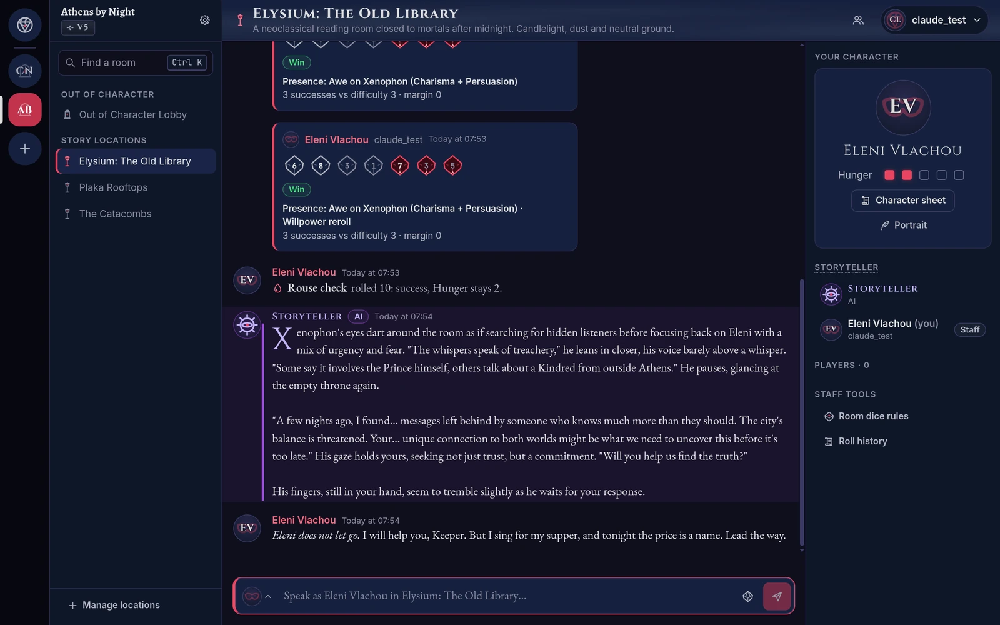

| Sign-in | Chronicle hall | Bestial failure |
|---|---|---|
| 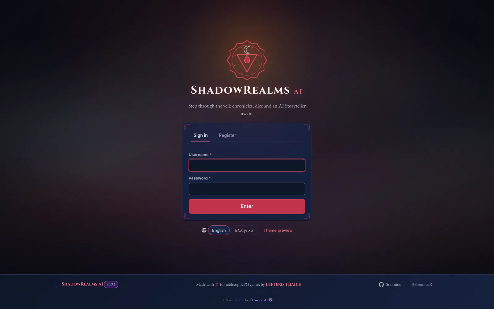 | 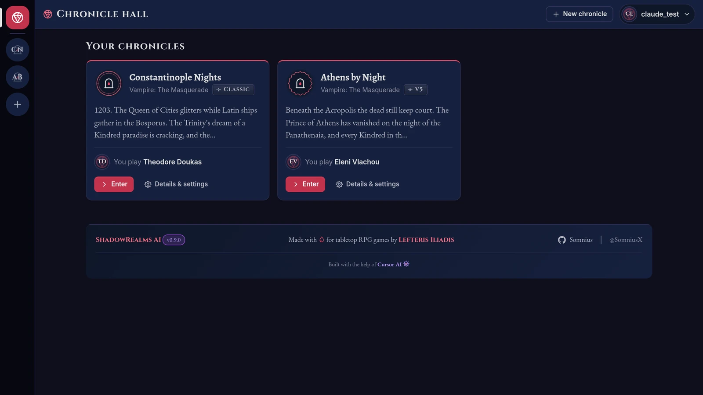 | 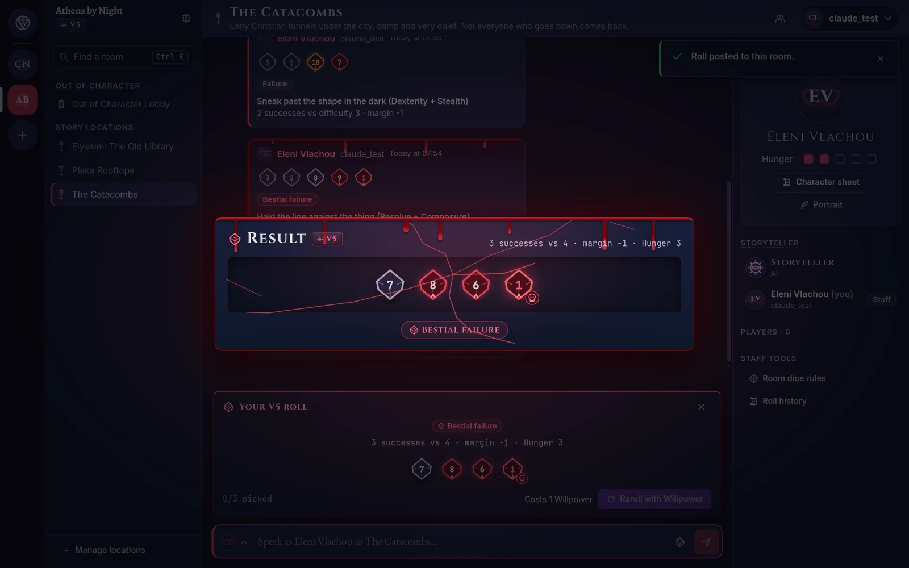 |

| V5 character sheet | Playing in Greek | Theme preview |
|---|---|---|
|  |  |  |

**Voice (0.16 to 0.22):** hear the chat read aloud, record your lines, read along.

| Read along | Recording on a phone | Reviewing before transcription |
|---|---|---|
| 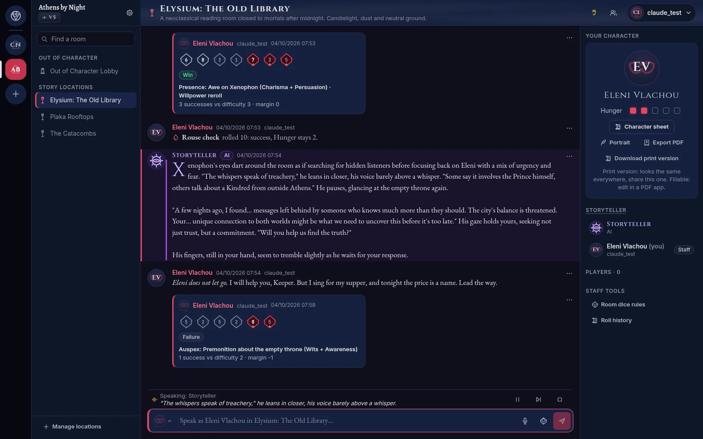 | 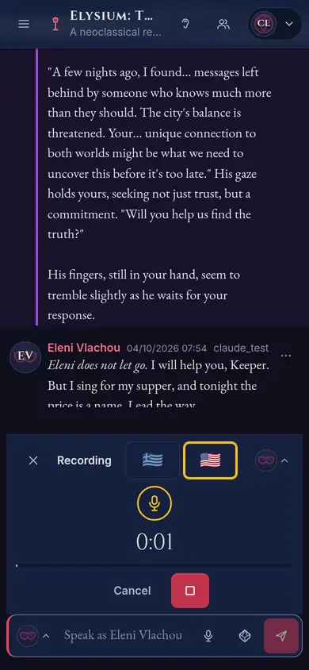 | 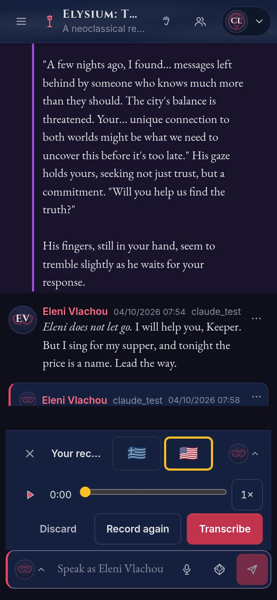 |

| Read this / Read from here | Your voice settings | A chronicle's voice settings |
|---|---|---|
| 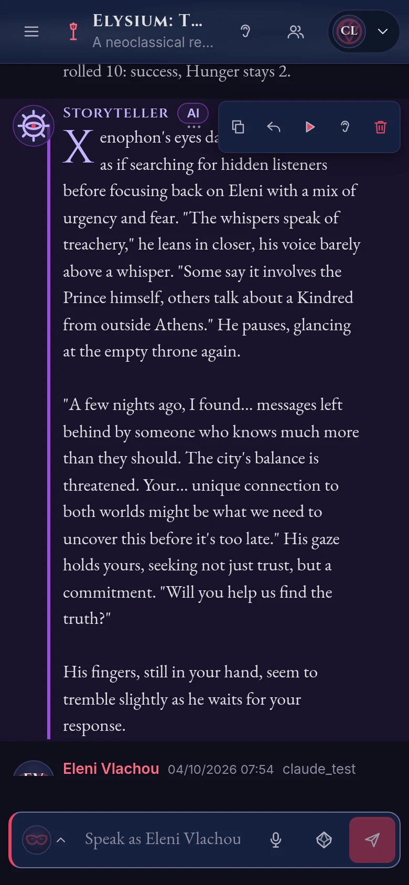 | 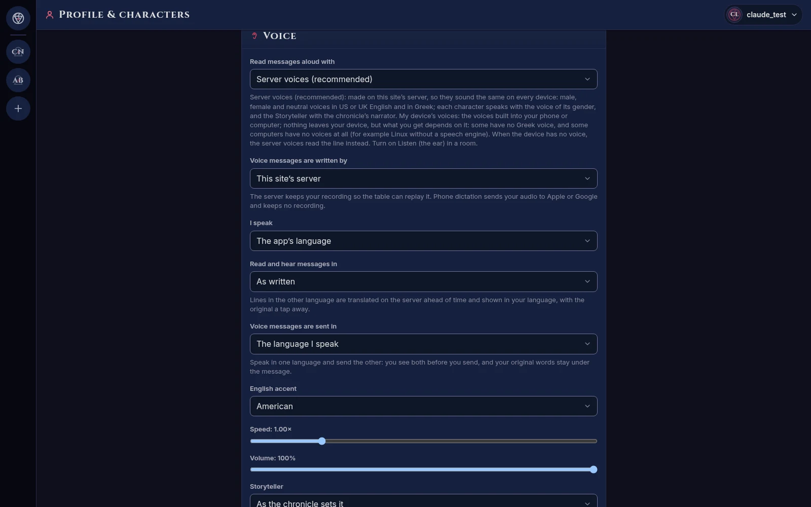 | 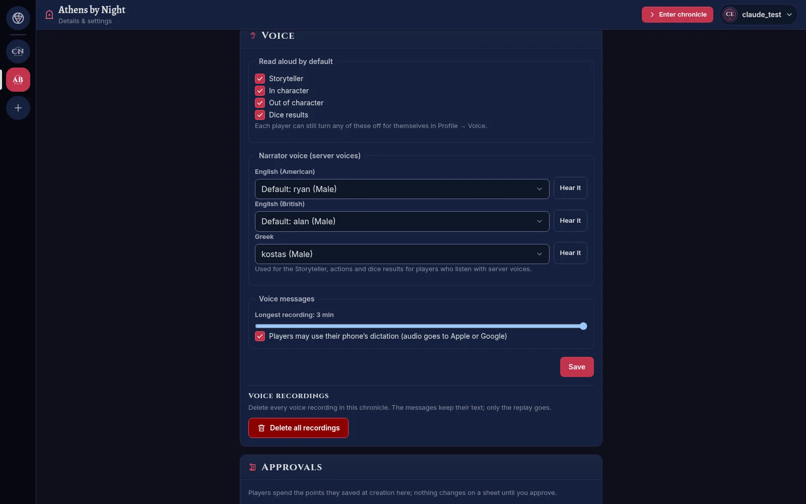 |

More: [the voice screenshots with captions](assets/screenshots/v0.22/README.md), [read along, animated](assets/screenshots/v0.22/read-along-animated.webp), [all v0.9 screenshots with captions](assets/screenshots/v0.9/README.md) and [a V5 roll, animated](assets/screenshots/v0.9/dice-roll-v5-animated.webp).

---

## What it is

ShadowRealms AI is a web app for running World of Darkness chronicles with an AI Storyteller. You host it yourself: Docker for the app, and local language models through LM Studio and Ollama, so the stories stay on your machine. Every chronicle is either Classic (oWoD Revised) or V5, and the interface and the Storyteller work in English and Greek.

## Features

### Rules editions

- Each chronicle picks **Classic** (Vampire, Werewolf, Mage on the Revised rules) or **V5** (Vampire: The Masquerade 5th edition) when it's created, and keeps it.
- Classic dice follow Revised: difficulty 2 to 10, 1s cancel successes, a botch only when nothing succeeded, specialties re-roll 10s, Willpower as one uncancellable success.
- V5 dice: Hunger dice, pairs of 10s, messy criticals, bestial and total failures, Willpower rerolls, Rouse checks.
- The Storyteller's prompt and the rule-book search follow the chronicle's edition. The rules as the app implements them: [Classic](docs/rules/CLASSIC_REVISED.md) and [V5](docs/rules/V5.md).

### Play

- Discord-style chat: grouped messages, unread counts, jump to present, in-character and out-of-character rooms.
- Live updates over server-sent events (falls back to polling).
- Dice cards: rolls are made and posted by the server, so a dice card in the chat is always a real roll.
- When the Storyteller calls for a roll, the server works out the pool from your sheet (specialties, Hunger, impairment) and the chat shows a roll chip that fills in the dice dialog.
- Copy, reply (with a quote) and delete on messages: players delete their own, the Storyteller and admins delete any. Scroll up to load older history.
- Slash commands with autocomplete: `/roll`, `/me`, `/chat` for everyone, and `/ai` commands for admins (`/ai help` lists them).
- One "Speaking as" control: your character, yourself out of character, or the Storyteller voice for staff.

### Voice

All of it runs on your own server, in the optional `speech` container (Piper and Pocket TTS for the voices, Whisper on the GPU for transcription). Details in [docs/VOICE.md](docs/VOICE.md).

- **Listen.** The ear in a room's header reads the chat aloud, with the phone's own voices or the server's. A character speaks with a voice of its gender (female, male or neutral, set on its sheet), or a voice its player picks; the Storyteller, actions and dice use the chronicle's narrator voice, in American English, British English or Greek. The chronicle's creator sets what's read by default (Storyteller, in character, out of character, dice) and each player can turn things off, with speed (0.75–2×) and volume.
- **Read along.** Lines are spoken sentence by sentence, so a long reply starts after its first sentence. The message being read is highlighted and followed, and the bar shows the sentence being said. "Read this" and "Read from here" on any message (long press on a phone), and a catch-up choice when you turn Listen on (last 3, last 10, from where you stopped). Dice are read as one sentence in your language.
- **Speak.** The mic in the message box records up to 3 minutes (per chronicle), with a large timer and a ring that pulses every 5 seconds and changes colour after each minute. Listen back with seek and speed, pick the language you spoke (🇬🇷 / 🇬🇧), transcribe, fix the text and send it in character, as a quote or out of character. Hold Space to talk on a computer, or use the phone's own dictation.
- **Voice messages for everyone.** Voice lines carry a mic every player sees and the recording plays from the chat. Recordings are kept for the chronicle's lifetime as Opus at 16 kbps, and deleted with their message or the chronicle (or all at once by the Storyteller).
- **Transcript check.** The chronicle's names and a game glossary are given to Whisper, [Laya-words](https://huggingface.co/somniusx/recmeets-laya-words) marks the words that were probably misheard, and Llama-Krikri fixes only those, keeping slang and swearing.
- **In your language.** Read and hear the chat in English or Greek whatever each player writes, with "Show original" under every translated line; speak Greek and send English. The translator keeps the chronicle's names untouched.
- **Greek names in English voices** are said the Greek way, not spelled letter by letter.

### Characters

- A character forge per edition: Classic with the Revised budgets (7/5/3, 13/9/5, virtues, 15 freebies), V5 in the corebook's order with all 16 clans, powers, rituals, predator types, Merits, Flaws and loresheets picked from a catalog built from the books (with short descriptions in English and Greek), a guided mode for new players, a check on the server, and creation rules each Storyteller sets per chronicle.
- Read-only sheets with trackers (Hunger, Willpower, Humanity), portraits, and one playing character per chronicle.
- Ghoul sheets for both editions, made from a vampire's sheet ("Add a ghoul retainer"): V5 retainers on the corebook's mortal templates or player ghouls by the Players Guide, with a level 1 power from the domitor and a Blood Bond (no blood pool, as in V5); Classic Revised ghouls by *Ghouls: Fatal Addiction*, with their Blood Pool. A ghoul follows its domitor, and the AI Storyteller knows about it.
- Character sheets export to PDF, V5 and Classic, ghouls included: a fillable version, and a print version without form fields that looks the same in every PDF viewer. Long backgrounds and notes continue on extra pages.
- Sheets lock after creation; later changes go through downtime requests the Storyteller approves.

### AI

- Roles instead of one model: English Storyteller, Greek Storyteller, utility and classifier, each set in the admin panel.
- Greek replies with `llama-krikri-8b-instruct`; the Storyteller answers in the player's language.
- Long-term memory and rule-book search with multilingual `bge-m3` embeddings in ChromaDB.
- OOC rooms are moderated by the Laya classifier (trained locally from `ml/laya/`) or the loaded LLM; warnings and bans apply per chronicle.
- Optional cloud providers: an admin can add Anthropic or OpenAI API keys (stored encrypted, off by default).

### Gothic theme

- 97 original SVG glyphs and sigils, animated dice, fog, candle glow and blood effects on botches.
- An atmosphere setting per account: Full, Subtle or Off.
- A guided theme preview at `/showcase`.

### Security

- Rate limits and lockouts, 30-minute access tokens with refresh rotation and revocation, a password policy, a login audit.
- Log lines can't be forged: control characters in anything a client sends are escaped.
- gunicorn behind nginx with a strict Content-Security-Policy; only nginx is reachable from the network.
- See [SECURITY.md](SECURITY.md) and [docs/SECURITY_MODEL.md](docs/SECURITY_MODEL.md).

### Admin

- Invite codes, all chronicles, users (bans, password resets), downtime requests, the moderation log.
- Logins & lockouts: lift a lockout by username or IP, and a paged login audit.
- Laya: label player chat and run an evaluation of the classifier against those labels ([docs/laya/](docs/laya/HOWTO.md)).
- AI system: models per role, cloud keys, embeddings and re-embedding.

---

## Quick start

You need Linux with Docker and the Compose v2 plugin (`docker compose`), [LM Studio](https://lmstudio.ai/) with its `lms` command, and [Ollama](https://ollama.com/) on the host. An NVIDIA GPU is strongly recommended. The [Installation](https://github.com/Somnius/shadowrealms-ai/wiki/Installation) page in the wiki has every step in detail.

1. Clone the repository and create your config:

```bash
git clone https://github.com/Somnius/shadowrealms-ai.git
cd shadowrealms-ai
cp env.template .env
cp backend/invites.template.json backend/invites.json
python3 scripts/generate_secret_key.py
```

2. Edit `.env`: put your own keys in `FLASK_SECRET_KEY` and `JWT_SECRET_KEY`, and generate `POSTGRES_USER` and `POSTGRES_PASSWORD` ([how](docs/POSTGRESQL_ENV_SETUP.md)). Never keep the template values.
3. Edit `backend/invites.json`: replace the example codes with your own random ones and keep one admin code for yourself. Registration needs an invite code.
4. Download `llama-krikri-8b-instruct` and `text-embedding-bge-m3` in LM Studio, then load them. `gemma-4-e2b` is an optional smaller English chat model (`lms get gemma-4-e2b --gguf -y`).

```bash
lms server start
lms load llama-krikri-8b-instruct -y    # Storyteller, English and Greek
lms load text-embedding-bge-m3 -y       # memory and rule-book embeddings
ollama pull llama3.2:3b                 # utility model
```

5. Start the stack and build the frontend:

```bash
./docker-up.sh
./scripts/build-frontend.sh
```

6. Optional, for the voice: set `SPEECH_SECRET` in `.env` and start the speech container with `docker compose --profile voice up -d speech` (an NVIDIA GPU for transcription; the voices run on the CPU). See [docs/VOICE.md](docs/VOICE.md).

7. Open http://localhost, register with your admin invite code (passwords need 12+ characters), create a chronicle, and type `/ai health` in its chat to check LM Studio, Ollama and ChromaDB.

For development, `docker compose --profile dev up -d frontend` starts the live-reload frontend (point nginx at it, see [docs/DOCKER_ENV_SETUP.md](docs/DOCKER_ENV_SETUP.md)), and `APP_SERVER=flask` with `FLASK_ENV=development` in `.env` runs the Flask dev server instead of gunicorn. Don't use the dev server on anything reachable from outside.

## Models and hardware

| Role | Default | Where to change it |
|---|---|---|
| Storyteller (English) | the model LM Studio has loaded | Admin, AI system, or `LM_STUDIO_MODEL` |
| Storyteller (Greek) | `llama-krikri-8b-instruct` (LM Studio) | Admin, AI system, or `STORYTELLER_EL_MODEL` |
| Utility | `llama3.2:3b` (Ollama) | Admin, AI system, or `UTILITY_PROVIDER` and `UTILITY_MODEL` |
| Classifier | Laya if its model is in `data/laya/model`, otherwise the loaded LM Studio model | Admin, AI system (also Typesafe Jev with a key) |
| Embeddings | `text-embedding-bge-m3` (LM Studio) | `EMBEDDING_MODEL` (the collections are re-embedded at the next start) |
| Translator | `llama-krikri-8b-instruct` (LM Studio) | Admin, AI system |
| Voices | Piper (English: lessac, ryan, alan, jenny, cori) and Pocket TTS Greek (kostas, spyros, eleni, athina; Piper rapunzelina as fallback) | the `speech` container, catalog in `speech/app/catalog.py` |
| Transcription | faster-whisper `large-v3-turbo` (int8_float16, GPU), checked by Laya-words | `VOICE_STT_MODEL`, `VOICE_TRANSCRIPT_CHECK` |

- It's developed on Linux with a 16 GB NVIDIA GPU. Krikri needs about 5 GB of VRAM.
- If something else holds the GPU, load only Krikri in LM Studio: the English role follows the loaded model, so Krikri then answers in both languages.
- A Storyteller reply gets 45 seconds per model and 55 seconds in total before it falls back (`STORYTELLER_ATTEMPT_TIMEOUT`, `STORYTELLER_TIME_BUDGET`).
- More in the wiki's [AI Models](https://github.com/Somnius/shadowrealms-ai/wiki/AI-Models) page and [docs/AI_SYSTEMS.md](docs/AI_SYSTEMS.md).

## Tech stack

| | |
|---|---|
| Voice | [Piper](https://pypi.org/project/piper-tts/) and [Pocket TTS](https://huggingface.co/myned-ai/pocket-tts-greek) for speech, [faster-whisper](https://github.com/SYSTRAN/faster-whisper) for transcription, Laya-words on ONNX Runtime for the transcript check, FastAPI, Opus recordings |
| AI models | Llama-Krikri 8B for the Greek Storyteller and any model in [LM Studio](https://lmstudio.ai) for English; Llama 3.2 3B on [Ollama](https://ollama.com) for utility calls; bge-m3 embeddings; **Laya**, our own fine-tuned mmBERT chat classifier on ONNX Runtime (CPU); optional Anthropic / OpenAI / Typesafe Jev with an admin-set key |
| Memory and rules search | RAG on ChromaDB 1.5.9 with bge-m3 |
| Backend | Python 3.12, Flask 3.1 on gunicorn 26, PostgreSQL 16, Redis 7, server-sent events |
| Frontend | React 18, Vite 8, react-router 7, motion, i18next (English and Greek), DOMPurify, d3, own SVG design system |
| Infrastructure | Docker Compose (the voice in its own `speech` container, `--profile voice`), nginx with a strict CSP, NVIDIA container runtime |
| Quality and security | GitHub Actions (pytest, Jest, ESLint, schema checks), CodeQL, Dependabot, branch protection |

The full list with versions, how Laya was trained, and how each release was built: [docs/TECH_STACK.md](docs/TECH_STACK.md).

---

## Documentation

- [docs/README.md](docs/README.md): index of everything in `docs/`
- [docs/TECH_STACK.md](docs/TECH_STACK.md): the AI models, technologies and tools used
- Wiki: [Installation](https://github.com/Somnius/shadowrealms-ai/wiki/Installation), [Configuration](https://github.com/Somnius/shadowrealms-ai/wiki/Configuration), [Rules Editions](https://github.com/Somnius/shadowrealms-ai/wiki/Rules-Editions), [AI Models](https://github.com/Somnius/shadowrealms-ai/wiki/AI-Models), [Architecture](https://github.com/Somnius/shadowrealms-ai/wiki/Architecture), [Security](https://github.com/Somnius/shadowrealms-ai/wiki/Security), [Troubleshooting](https://github.com/Somnius/shadowrealms-ai/wiki/Troubleshooting)
- [docs/CHANGELOG.md](docs/CHANGELOG.md): every release
- [docs/VOICE.md](docs/VOICE.md): listening, speaking, translation and the speech service; plan in [docs/ROADMAP_VOICE.md](docs/ROADMAP_VOICE.md)
- [docs/ROADMAP_CHRONICLE.md](docs/ROADMAP_CHRONICLE.md): next, "The chronicle so far"
- [docs/ROADMAP_v0.10.md](docs/ROADMAP_v0.10.md): the plan from v0.9.2 to v0.10
- [docs/ROADMAP_v0.9.md](docs/ROADMAP_v0.9.md): the v0.9 plan

---

## Contributing

Contributions are welcome. Read [docs/CONTRIBUTING.md](docs/CONTRIBUTING.md) first, and use [GitHub Issues](https://github.com/Somnius/shadowrealms-ai/issues) for bugs and feature ideas.

## Security

Please don't open a public issue for a vulnerability. Report it privately from the Security tab of this repository; [SECURITY.md](SECURITY.md) has the details.

## License

MIT, see [LICENSE](LICENSE).

## Credits

- Made with ❤️ for tabletop RPG games by **Lefteris Iliadis** ([Somnius](https://github.com/Somnius), @SomniusX).
- Greek Storyteller model: Llama-Krikri by ILSP. Embeddings: bge-m3 by BAAI.

## Disclaimer

Not affiliated with or endorsed by Paradox Interactive or White Wolf/Renegade; World of Darkness and Vampire: The Masquerade are their trademarks. All glyphs and sigils are original; no rulebook text is included — bring your own books.
